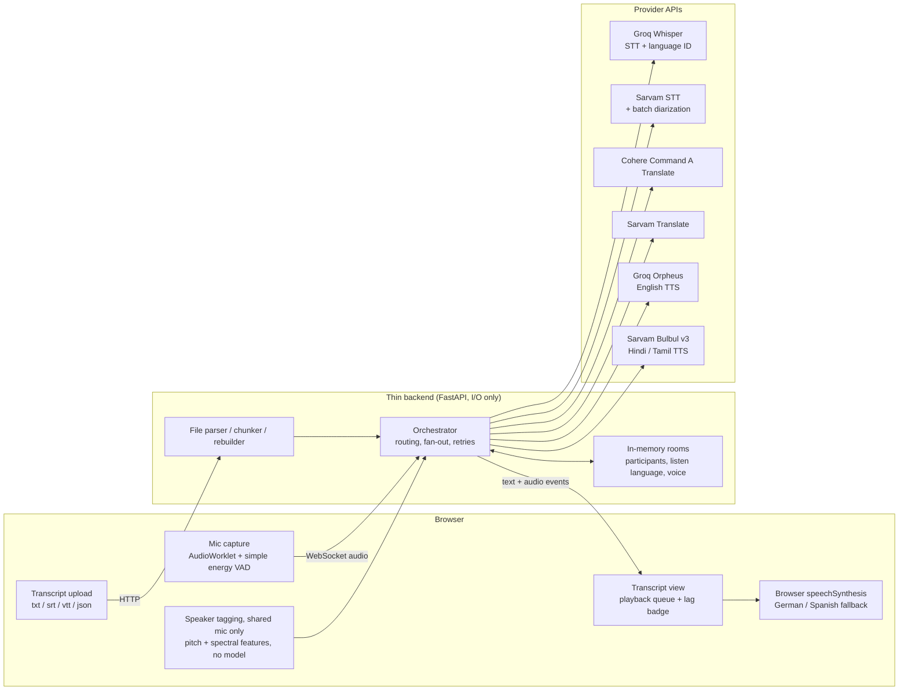

# Polyglot Ear: API-Based Demo Architecture

**Based on:** BRD-S2ST-001 v1.0 (cascade approach), scaled down for a demo
**Goal:** Capture speech (one or many speakers), or take a shared transcript file, and deliver translation as text and, in live modes, as spoken audio, with a distinct voice per speaker.
**Approach:** no local models and no GPU/CPU dependency. The browser captures audio; a thin backend orchestrates **Groq, Sarvam and Cohere** APIs. Voyage and Jina are not used (they offer embeddings and rerankers, which have no role here).

---

## 1. Scope

| Area | Demo |
|---|---|
| Front end | Single-page web app: three tabs (Speak, Upload transcript, Multi-user) |
| Languages | **English, Hindi, German, Spanish, Tamil**, in three pairs, both directions: **English ↔ Hindi**, **German ↔ English**, **Spanish ↔ Tamil** |
| Vendors | **Groq, Sarvam, Cohere only.** Gaps are handled with workarounds (section 8), not extra vendors |
| Speaker handling | Multi-user supports **both** setups: each person on their own device, and one shared mic with several people |
| Output | Live modes: text + spoken translation. Transcript upload: translated text file |
| Privacy | Nothing stored; audio and text are processed in memory only |
| Hardware | Backend: any small VM or laptop (Python 3.11+, ~512 MB RAM, no GPU, no model downloads). Browser: current Chrome / Edge / Safari / Firefox with mic permission |

---

## 2. System overview



**Design choice:** one stateless-ish Python process (rooms held in memory), async calls to providers, no database, no queue. API keys live only on the backend.

---

## 3. The three modes

### Mode 1: User speaks (live mic, or an uploaded audio clip)
1. Browser captures 16 kHz mono audio; a simple energy VAD closes an utterance after ~500 ms of silence (forced cut at ~10 s).
2. Backend runs **ASR + language ID** (routing in 4.1).
3. **Translate** into the chosen target language (4.2).
4. **Synthesize** speech with a voice for the target language (4.3).
5. Browser shows source and translated text, and plays the audio.

### Mode 2: User shares a transcript file
1. Upload `.txt`, `.srt`, `.vtt` or `.json` (`[{speaker, start, end, text}]`). No speech models are involved.
2. Backend parses cues and keeps speaker labels and timestamps untouched.
3. Source language: user picks it, or "auto" (script check for Devanagari and Tamil, plus a language-ID call for Latin-script text).
4. Translate cue by cue for Sarvam routes (character limits apply). For Cohere routes, batch numbered cues in one request, check that the count matches on return, and fall back to cue by cue if it does not.
5. Rebuild the file in the same format and offer it as a download. No audio output.

### Mode 3: Multiple users speak
Identify who spoke, translate, and deliver in each listener's expected language. Two supported setups:

**3a. Separate devices (exact identity).**
- A host creates a room; each participant joins with a display name, a **listen language** and a voice style (male / female).
- Each device's audio is tagged with its participant id, so **no speaker separation is needed**.
- For every utterance: transcribe once, translate once per distinct listener language, synthesize once per (target language, speaker voice), and fan the results out to the matching listeners. Listeners who share the speaker's language get the original text only.

**3b. One shared mic (approximate identity).**
- A browser-side tagger assigns "Speaker 1..4" per utterance (section 5). The room has one target language; others can join as listener-only devices as in 3a.
- Users can correct a label with one tap (merge, rename, reassign).
- For uploaded recordings in English, Hindi or Tamil, an optional **Sarvam batch job with diarization** gives better labels, at the cost of being asynchronous (not live).

---

## 4. Provider routing

### 4.1 Speech recognition and language ID
| Pair | Route |
|---|---|
| German ↔ English | **Groq Whisper** (response includes the detected language and segment timestamps) |
| English ↔ Hindi | **Sarvam STT** with automatic language detection (code-mixed mode for Hinglish) |
| Spanish ↔ Tamil | **Groq Whisper and Sarvam STT in parallel**; if Whisper reports Tamil or Hindi, use Sarvam's text, otherwise use Whisper's |

### 4.2 Translation
| Direction | Route |
|---|---|
| English → Hindi, Hindi → English | **Sarvam Translate** (`mayura:v1`; `sarvam-translate:v1` for longer text) |
| German ↔ English | **Cohere Command A Translate** (`command-a-translate-08-2025`, via the Chat endpoint) |
| Spanish → Tamil | Cohere (Spanish → English), then Sarvam (English → Tamil) |
| Tamil → Spanish | Sarvam (Tamil → English), then Cohere (English → Spanish) |
| Other combos (optional) | German / Spanish ↔ Hindi: Cohere directly. Anything with Tamil: pivot through English |

Tamil is not among Cohere's 23 languages, which is why Tamil routes through English. Two hops add latency and compound errors.

### 4.3 Speech output
| Target | Engine | Voice pool |
|---|---|---|
| English | **Groq Orpheus (English)** | female: autumn, diana, hannah; male: austin, daniel, troy |
| Hindi | **Sarvam Bulbul v3** | male: shubh, ashutosh; female: priya, suhani |
| Tamil | **Sarvam Bulbul v3** | male: ratan, rohan; female: ishita, ritu |
| German, Spanish | No voice among the three vendors | Show captions and use the browser's built-in `speechSynthesis` voices (fallback) |

### 4.4 What each direction delivers
| Direction | Text | Spoken |
|---|---|---|
| English → Hindi | yes | Sarvam voice |
| Hindi → English | yes | Orpheus voice |
| German → English | yes | Orpheus voice |
| English → German | yes | browser device voice (fallback) |
| Spanish → Tamil | yes | Sarvam voice |
| Tamil → Spanish | yes | browser device voice (fallback) |

---

## 5. Speaker identity and voice assignment

**Separate devices (3a):** identity comes from the connection. Voice style is declared at join, so no classification is needed.

**Shared mic (3b):** the AudioWorklet computes a few cheap features per utterance (median pitch via autocorrelation, spectral centroid, band-energy ratios). No model, negligible CPU.
- Online nearest-centroid clustering with a distance threshold; max 4 speakers; extras merge into the nearest.
- Profile from median pitch: below ~165 Hz male; ~165-255 Hz female; above ~255 Hz child; near a boundary or too little voiced audio gives neutral.
- Hysteresis: lock a profile after 2 consistent estimates, change only after 3 contrary ones, so a voice does not flip mid-scene.
- This is a heuristic. It will not match a real diarization model, fails on overlap and on similar voices, and does not meet the BRD's accuracy target.

**Voice choice:** pick from the target language's pool by profile (male / female). A second speaker with the same profile gets the next voice in the pool. Child and neutral profiles use a female voice, since none of the vendors offers child voices. Voice assignments last for the session only.

---

## 6. Interfaces

**WebSocket `/ws/session`** (one per participant or device)
| Direction | Message | Payload |
|---|---|---|
| Client to server | `config` | `{mode, target_lang, room?, name?, voice_style?}` |
| Client to server | audio (binary) | one VAD-closed utterance (PCM16 or WAV) plus optional speaker features |
| Client to server | `relabel` | `{speaker_id, new_label}` |
| Server to client | `utterance` | `{id, speaker, colour, src_lang, src_text, tgt_text, tgt_lang}` |
| Server to client | audio (binary) | WAV for the preceding utterance id (absent when no voice exists) |
| Server to client | `status` | stage timings, errors, fallbacks used |

**HTTP**
- `POST /api/rooms` creates a room; `POST /api/rooms/{id}/join` joins it.
- `POST /api/translate-file` takes a file plus `{source_lang|auto, target_lang}` and returns the translated file.
- `POST /api/diarize-recording` (optional) starts a Sarvam batch job and returns labelled segments.

---

## 7. Latency, limits and cost

| Stage | Rough time per ~4 s utterance |
|---|---|
| Endpointing wait | ~0.5 s |
| ASR | ~0.5-1.5 s |
| Translation | ~0.3-1.2 s (about double for Tamil pivots) |
| TTS | ~0.5-1.5 s |
| **Processing after speech ends** | **~2-5 s** |

Perceived lag is the utterance length plus processing, so roughly 4-9 s. These are estimates to measure, and they depend on network and provider load. The BRD's 3 s median target is not met by this utterance-level design.

Known per-request limits to design around (confirm in each console before building):
- Sarvam Translate: 1,000 characters (`mayura:v1`) or 2,000 (`sarvam-translate:v1`) per request.
- Sarvam Bulbul v3: 2,500 characters per request.
- Sarvam batch STT: up to 1 hour per file, up to 20 files per job, chunk-level (not word-level) timestamps.
- Cohere Command A Translate: 8K tokens in, 8K out.
- Groq Orpheus: short input per call (reported around 200 characters), so chunk by sentence; fixed 48 kHz output.

Each utterance costs roughly 3 API calls per target language (ASR, translate, TTS), plus one extra for the parallel ASR route (Spanish ↔ Tamil) and one extra per pivot. Free-tier rate limits and pricing were not verified; add per-provider concurrency caps, one retry, and a ~8 s timeout.

---

## 8. Gaps and workarounds (vendors limited to Groq, Sarvam, Cohere)

| Gap | Workaround |
|---|---|
| No live diarization API in the three vendors (Sarvam's diarization is batch only, and covers Indian languages and English) | Separate-device rooms give exact identity; shared mic uses the browser tagger with manual correction; optional Sarvam batch diarization for en / hi / ta recordings |
| No German or Spanish TTS | Captions plus browser `speechSynthesis` (voice and gender depend on the device) |
| No Tamil in Cohere translation | Pivot through English |
| No child voices anywhere | Female voice for child and neutral profiles |
| English TTS only through Groq Orpheus | Spoken English is available; no other Groq language voices |
| Spanish ASR is not covered by Sarvam | Whisper on Groq for Spanish, run in parallel with Sarvam for the Spanish ↔ Tamil pair |

---

## 9. Project layout

```
polyglot-ear-api-demo/
├─ backend/
│  ├─ main.py            # FastAPI: /ws/session, /api/rooms, /api/translate-file
│  ├─ orchestrator.py    # per-utterance flow, fan-out, retries, fallbacks
│  ├─ routing.py         # language pair -> provider routing tables
│  ├─ providers/
│  │  ├─ groq_asr.py     # Whisper STT + language ID
│  │  ├─ groq_tts.py     # Orpheus English
│  │  ├─ sarvam.py       # STT, Translate, Bulbul TTS, batch diarization
│  │  └─ cohere_mt.py    # Command A Translate
│  ├─ rooms.py           # in-memory rooms, listen languages, voice assignment
│  ├─ files.py           # txt/srt/vtt/json parse, chunk, rebuild
│  └─ config.py          # env keys, timeouts, voice pools
├─ frontend/
│  ├─ index.html         # tabs: Speak / Upload transcript / Multi-user
│  ├─ app.js             # WebSocket, playback queue, UI
│  ├─ worklet.js         # capture, energy VAD, pitch/spectral features
│  └─ speaker.js         # approximate speaker tagging, relabel UI
└─ .env.example          # GROQ_API_KEY, SARVAM_API_KEY, COHERE_API_KEY
```

**Python dependencies (approx.):** `fastapi`, `uvicorn[standard]`, `httpx`, `python-multipart`. The vendors' official SDKs are optional.

---

## 10. Privacy and security

- API keys stay on the backend; the browser never sees them. Serve over HTTPS.
- Audio and text are processed in memory and not logged or stored. Uploaded files are discarded after the response.
- Audio and text leave the device and go to Groq, Sarvam and Cohere. Show a consent notice before the mic starts, and check each vendor's data retention and training terms (BRD NFR-08) before using real conversations.
- Label spoken output as synthetic (BRD FR-36).
- Not covered by the demo: BIPA, COPPA and EU AI Act items in BRD section 13.

---

## 11. Demo script (suggested)

1. **Speak:** English → Hindi live; show text plus the Hindi voice.
2. **Upload transcript:** a short German `.srt` translated to English; download the result.
3. **Multi-user, separate devices:** two phones join one room, one listening in English and one in Hindi; show fan-out.
4. **Multi-user, shared mic:** a recorded three-person scene; show the speaker tags and a manual relabel.
5. **Point out:** the fallbacks (browser voice for German / Spanish, Tamil pivot) and the lag badge.

---

## 12. Path from demo to MVP

| Demo component | MVP replacement |
|---|---|
| Browser speaker tagger | Streaming diarization API or on-server model |
| Browser voices for German / Spanish | Licensed multilingual TTS with real voice pools, including child voices |
| Utterance-level calls | Streaming ASR, MT and TTS over WebSockets |
| Tamil pivot through English | Direct Spanish ↔ Tamil translation |
| Single process, in-memory rooms | Managed backend with shared room state |

---

## 13. Assumptions to confirm

- Demo pairs are English ↔ Hindi, German ↔ English and Spanish ↔ Tamil, in both directions.
- Model IDs, voice names, limits and pricing change; confirm against each provider's console and docs when building.
- Demo clips and recordings are your own or licensed.
